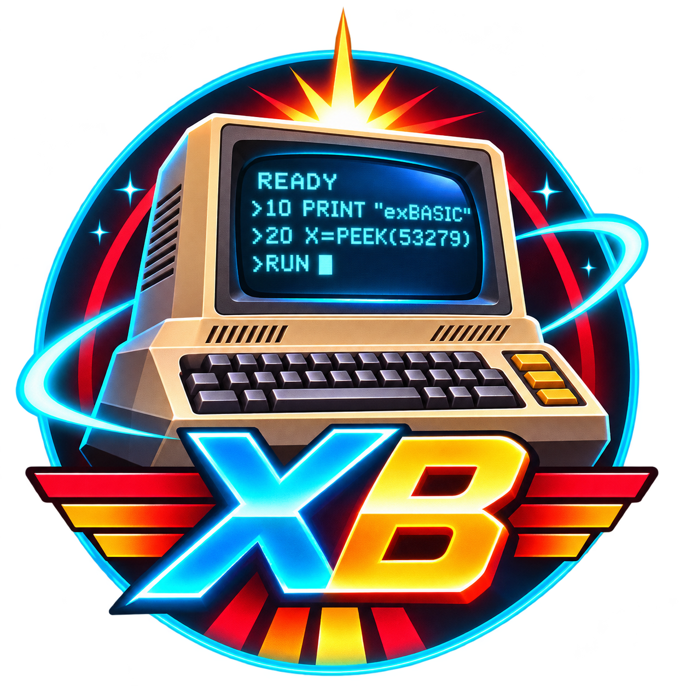

# exBASIC Studio

A desktop IDE for [exBASIC](third_party/exbasic/source/README.md) on Atari
8-bit computers: edit, build, run and debug in one window, with the
compiler, an Atari800-based emulator and ATR disk tools included.



## Features

- **Editor** with exBASIC highlighting, completion, signature help, hover
  documentation linked to the manual, folding, outline, go to definition,
  workspace symbols, split view and live diagnostics from the real compiler.
- **Build and run** with streamed output, cancellation and structured
  problems. Optional packaging into bootable SDFS or EOSFS ATR images.
- **Embedded Atari800** in an editor tab: machine profiles (400/800, XL, XE,
  5200, memory expansions, PAL/NTSC), floppy drives, the `H1:` host device
  mapped to the project, R: serial devices, IDE Plus and the EOS cartridge.
  A keyboard joystick (Q W E / A D / Z X C, arrows or keypad; Space, Numpad 0
  or Ctrl to fire) and a *Keyboard* panel that shows where every Atari key
  is on a PC or Mac keyboard.
- **Source-level debugger**: breakpoints on BASIC lines, stepping by line or
  6502 instruction, step over and out, watches, registers, return stack,
  disassembly and a memory viewer.
- **ATR explorer**: browse, import, extract, rename and delete inside SDFS
  and EOSFS images, with drag and drop to and from the project.
- **Sprite Studio**: a pixel editor for player/missile sprites with frames,
  onion skin, animation preview and a palette that maps each colour to the
  player planes it sets. It opens sprite sheets, plain frames JSON, PMG banks
  and PNGs, generates the PMG bank, its index, an exBASIC `DATA` include and
  a PNG atlas, and merges several sheets into one bank. See
  [docs/SPRITES.md](docs/SPRITES.md).
- **Git**: status, diff, staging, commits, branches, remotes, fetch/pull/push
  and merge conflict resolution.
- **Terminal**: real shell sessions.
- **Claude Code** in a terminal tab (sparkle button or *Claude Code: Open in
  Terminal*), briefed on exBASIC: it reads the bundled manual and builds the
  project the way Studio does. Requires the Claude Code CLI
  (`irm https://claude.ai/install.ps1 | iex` on Windows,
  `curl -fsSL https://claude.ai/install.sh | bash` elsewhere); set
  `EXBASIC_STUDIO_CLAUDE` to use a copy installed somewhere unusual.
- **The exBASIC manual**, searchable, inside the application.
- **Safe by default**: folders you open are in restricted mode until you
  trust them; unsaved work is recovered after a crash; nothing is uploaded.

## Install

Download the artifact for your platform from the releases page:

| Platform | File |
|----------|------|
| Windows 10/11 x64 | `exbasic-studio-<version>-windows-amd64-setup.exe` or `…-portable.zip` |
| macOS 12+ (Intel and Apple silicon) | `exbasic-studio-<version>-macos-universal.dmg` |
| Linux x64 / arm64 | `…-linux-<arch>.AppImage`, `.deb` or `.rpm` |

Releases are signed and come with `SHA256SUMS.txt`, a bill of materials and
build provenance. There is no automatic updater: install a newer release
over the old one. See [docs/PLATFORMS.md](docs/PLATFORMS.md) for
requirements and [docs/SECURITY.md](docs/SECURITY.md) for how to verify a
download.

## Quick start

1. **Create a project** in the Explorer: choose a folder, type a name and
   press *Create Project*. Or *Open Folder* on an existing one.
2. Edit `src/main.bas`.
3. Press **Ctrl+F5** to build and run it in the emulator, or **F6** to build.
4. Click the gutter to set a breakpoint and press **F5** to debug.

| Key | Action |
|-----|--------|
| Ctrl+Shift+P | Command palette |
| Ctrl+P / Ctrl+T | Go to file / workspace symbol |
| F12 | Go to definition |
| Tab | Accept the highlighted suggestion |
| Ctrl+. | Apply the fix for the problem on the current line |
| F5 / Ctrl+F5 / F6 | Debug / run / build |
| F9, F10, F11 | Toggle breakpoint, step line, step instruction |
| Ctrl+` | Terminal |
| Ctrl+B, Ctrl+J | Toggle side bar, panel |
| F1 | Manual |

A folder you did not create opens in **restricted mode**: you can read and
edit, and Studio asks before it runs that folder's configured tools.

## Projects

A project is a folder; `exbasic.project.json` is optional and is written
when you save settings. See
[docs/PROJECT-CONFIG.md](docs/PROJECT-CONFIG.md) for the format and for
opening projects made with the alpha.

## Building from source

```
task toolchain                      # compiler, emulator helper and ATR tool from third_party/
cd frontend && npm ci && cd ..
task dev                            # development build with live reload
task check                          # everything CI runs
```

[CONTRIBUTING.md](CONTRIBUTING.md) lists the prerequisites and conventions;
[docs/ARCHITECTURE.md](docs/ARCHITECTURE.md) describes the structure.

## Documentation

- [CHANGELOG.md](CHANGELOG.md)
- [docs/ARCHITECTURE.md](docs/ARCHITECTURE.md)
- [docs/SECURITY.md](docs/SECURITY.md)
- [docs/PLATFORMS.md](docs/PLATFORMS.md)
- [docs/PROJECT-CONFIG.md](docs/PROJECT-CONFIG.md)
- [docs/SPRITES.md](docs/SPRITES.md)
- [docs/RELEASE_CHECKLIST.md](docs/RELEASE_CHECKLIST.md)
- [docs/ROADMAP-EXTENSIONS.md](docs/ROADMAP-EXTENSIONS.md) (extensions are
  planned after 1.0 and are not part of it)

## License

exBASIC Studio is MIT-licensed (see [LICENSE](LICENSE)).

The exBASIC compiler, the Atari800 emulator core with its helper, and
mkatr-go are GPL programs. They are built from the sources in
`third_party/` and run as separate processes; they are not linked into the
Studio executable. See [THIRD_PARTY_NOTICES.md](THIRD_PARTY_NOTICES.md).
